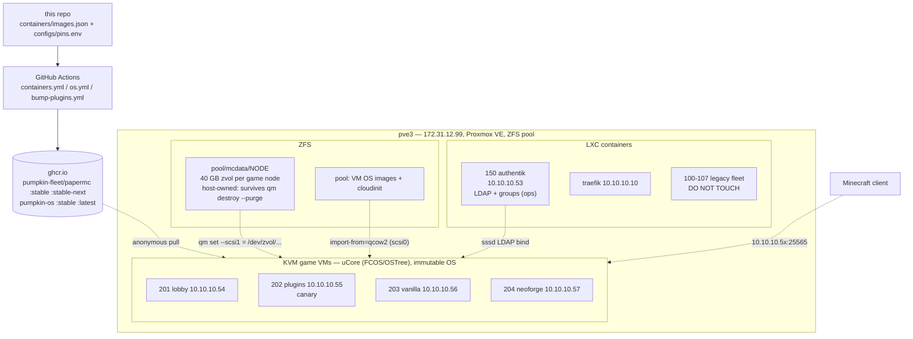
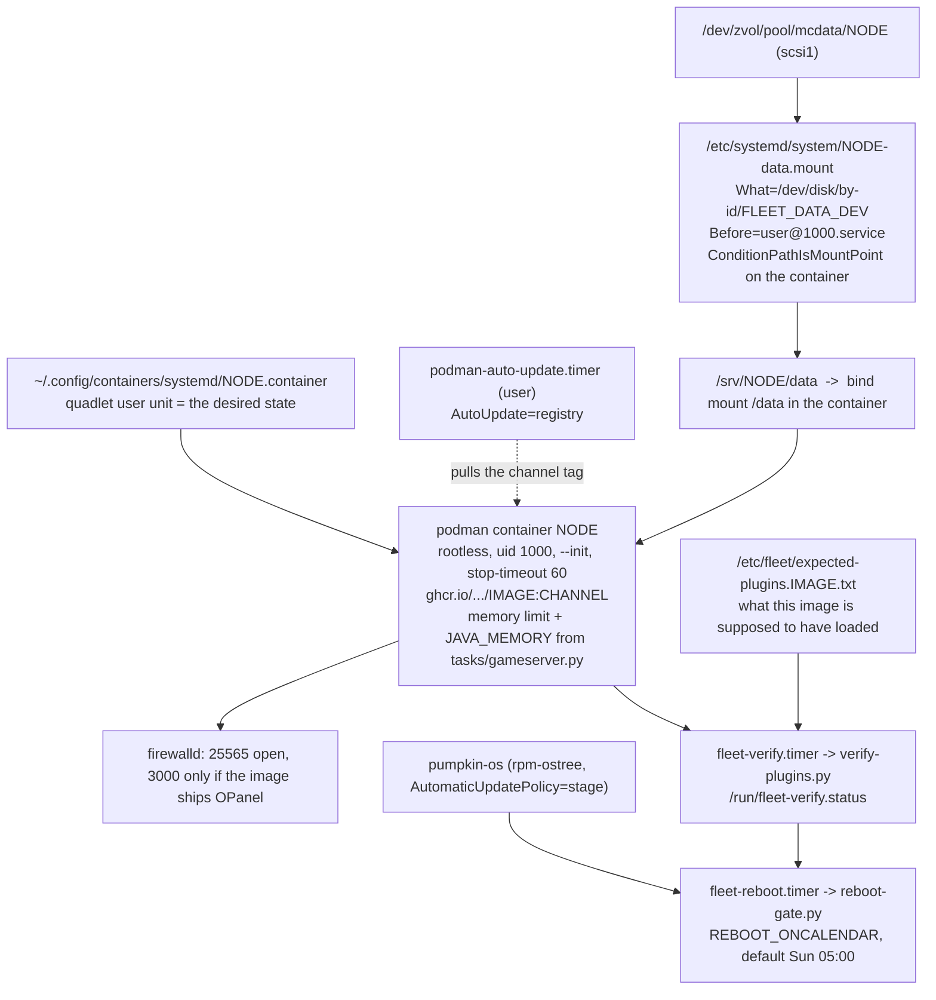
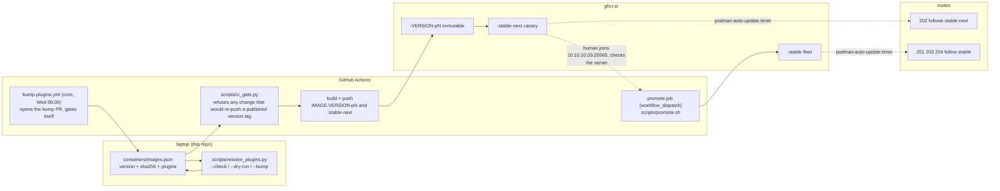
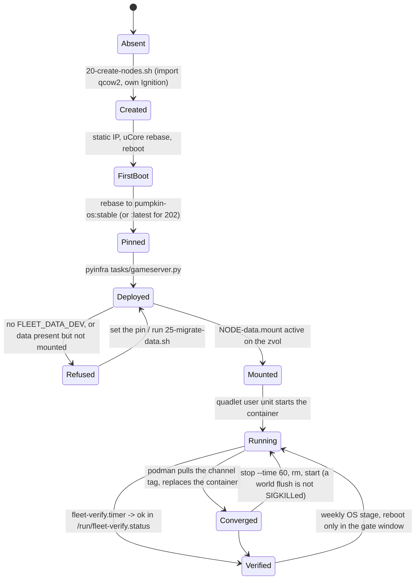
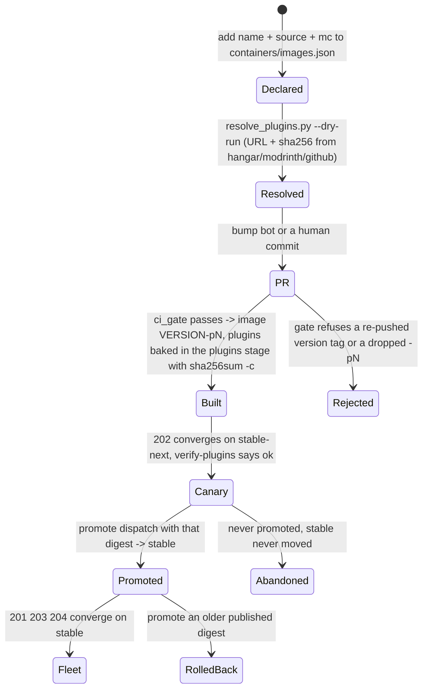
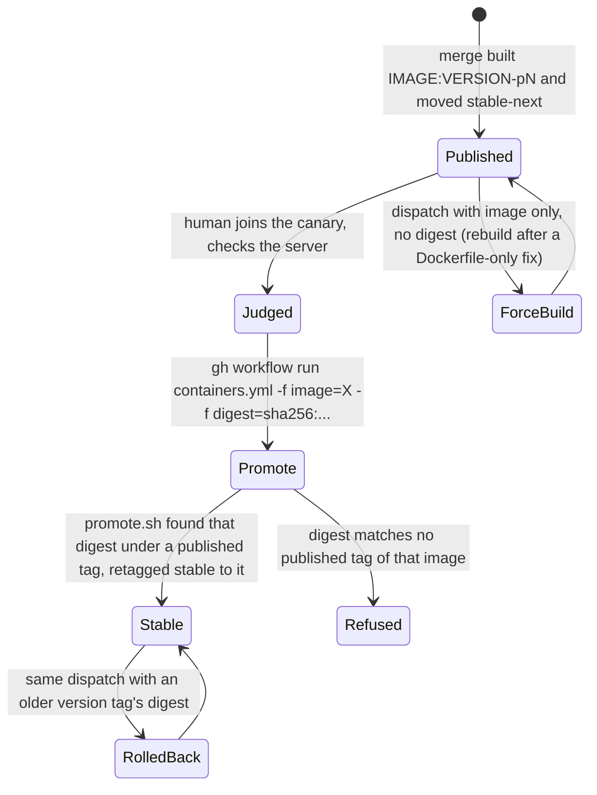
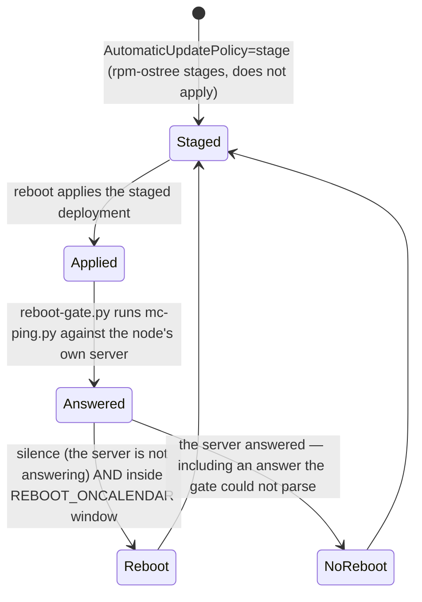
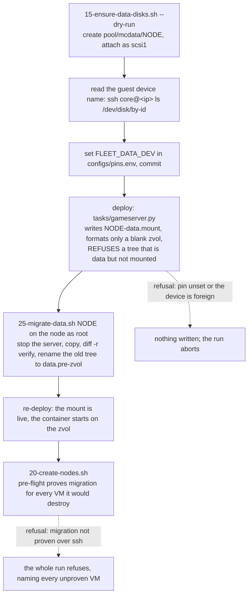

# pumpkin-fleet — operator guide

Everything you need to run the fleet: what is running where, how a plugin or an OS update
reaches a machine, and the exact commands for each day-2 job. Read `docs/spike-notes.md`
before fighting anything — it is the symptom-indexed record of everything that already cost
hours. `docs/plan.md` is the deployment checklist; `docs/superpowers/` holds the design specs
and plans this repo implements.

**Two mental models make every command obvious:**

1. **A node is disposable; its world disk is not.** The PVE host owns the world as a ZFS
   volume (`pool/mcdata/<node>`) attached to the VM as a second disk. Destroying the VM
   destroys only the OS disk.
2. **Git is the desired state; the node converges itself.** A merge publishes an image, a
   promote moves a channel tag, and `podman-auto-update.timer` converges the node. You do not
   ssh to ship a plugin.

---

## 1. The fleet

| VMID | Name | IP | Workload | Image | Image channel |
|---|---|---|---|---|---|
| 201 | `lobby` | 10.10.10.54 | Paper, 4 g / 2 G heap | `papermc` | `stable` |
| 202 | `plugins` | 10.10.10.55 | Paper, 4 g / 2 G heap — **canary** | `papermc` | `stable-next` |
| 203 | `vanilla` | 10.10.10.56 | Fabric + OPanel, 3 g / 2 G | `fabric` | `stable` |
| 204 | `neoforge` | 10.10.10.57 | NeoForge, 6 g / 4 G | `neoforge` | `stable` |
| 205 | `velocity` | 10.10.10.52 | proxy — *not built yet*; `velocity:stable` is not seeded | | |
| 150 | `authentik` (LXC) | 10.10.10.53 | identity: LDAP for node logins, Cockpit | | |
| 190 | `ucore-golden` | 10.10.10.99 | reference VM. **Never clone a booted FCOS VM** (spike-notes §5) | | |

Registry: `ghcr.io/jcpowermac/pumpkin-fleet/<image>:<version>` (server images) and
`ghcr.io/jcpowermac/pumpkin-os` (the node OS). There is **no `latest` tag for a server image**
by design, and a version tag is **never re-pushed** — a plugin change publishes a new `-pN`.

Out of scope and untouchable: the legacy LXC fleet on pve3, VMIDs **100-107**.

---

## 2. Infrastructure: from Proxmox to the container



### Inside one node (all four are identical in shape)



The container unit is **transient** (a quadlet generator unit): it is never `systemctl enable`d.
Boot starts come from its `[Install] WantedBy=default.target` on every `daemon-reload`.

---

## 3. Control plane: how a change reaches a machine



The OS image has the same shape: BlueBuild (os.yml, daily) publishes `pumpkin-os:latest`,
which is the **OS canary channel**; only 202 follows it. `pumpkin-os:stable` moves when a human
dispatches os.yml with the digest, and the other nodes rebase onto `:stable`.

---

## 4. State graphs

### 4.1 A node's life



### 4.2 A plugin change



`stale: true` / `note:` on a plugin mean *the pin did not move* — the resolver clears them when
it resolves a newer compatible artifact.

### 4.3 Promote and roll back (the only two ways a channel moves)



Rollback is **promote-only**. Merging a revert onto a `-pN` that ghcr already published would
re-push that tag with new bytes, so `ci_gate.py` refuses it: revert forward as a new `-pN`, or
promote the old digest.

### 4.4 OS updates and the reboot gate



`mc-ping.py` exit 2 means *answered with an unparseable payload*, which is deliberately **not**
"unreachable": a malformed status never authorizes a reboot. Only genuine silence does.

### 4.5 The world disk, and the rebuild order



`data.pre-zvol` is never deleted by the migration script. There is no `rm` in it.

---

## 5. Day-2 runbooks

### 5.1 Add or update a plugin

```bash
uv run python scripts/resolve_plugins.py --dry-run          # what would change, nothing written
uv run python scripts/resolve_plugins.py --bump --only papermc
uv run python scripts/resolve_plugins.py --check            # CI's form: non-zero if the manifest is stale
git diff containers/images.json                             # read it like a review
```

Then bump the image version's `-pN` (e.g. `26.3-258-p2` -> `26.3-258-p3`) in the same edit —
that is what makes the artifact new. Sources accepted: `hangar`, `modrinth`, `github`, `manual`.
A plugin with no compatible release stays declared with `stale: true` + a `note`.

### 5.2 The bump bot

`bump-plugins.yml` runs weekly (Wed 06:00), resolves everything, and opens a PR with the diff
and the reason. It gates itself (a GITHUB_TOKEN-authored PR does not trigger `pull_request`
workflows, so the bot runs `ci_gate.py` in its own job) and exits 0 (nothing newer) or 2 (PR
opened or a resolution problem). A PR you merge is a bump you reviewed.

### 5.3 Deploy / converge a node

```bash
uv run pyinfra inventory/hosts.py --limit plugins tasks/gameserver.py   # one node
uv run pyinfra inventory/hosts.py --group game_nodes tasks/gameserver.py # all four
uv run pyinfra inventory/hosts.py tasks/ping.py                          # connectivity gate
```

The deploy is idempotent and it is the applicator: the quadlet unit, the mount unit, the
expected-jar file, firewall ports, cockpit visibility drop-ins, the verify and reboot units, and
`podman-auto-update.timer`. It **refuses** rather than guessing a disk.

### 5.4 Verify a node

```bash
uv run pyinfra inventory/hosts.py --group game_nodes tasks/verify.py
```

Fails the run if any node's verdict is not `ok`, or if the node's expected-jar file no longer
matches `containers/images.json` (which `podman-auto-update.timer` can move long after a
deploy). On the node itself: `cat /run/fleet-verify.status`, `systemctl status fleet-verify.service`.

### 5.5 Promote: canary -> fleet

```bash
# 1. join the canary while it is on stable-next:  10.10.10.55:25565
# 2. take the digest 202 actually runs:
ssh core@10.10.10.55 "podman inspect --format '{{.ImageDigest}}' plugins"
# 3. move stable to it (registry-side retag, no rebuild):
gh workflow run containers.yml -f image=papermc -f digest=sha256:<digest>
```

Same shape for the OS: `gh workflow run os.yml -f digest=sha256:<latest's digest>`.

### 5.6 Roll back

`gh workflow run containers.yml -f image=<image> -f digest=sha256:<digest of an older published version tag>`.
Nothing else to do: the nodes converge on `stable` on their own timer. A digest that is not one
ghcr already serves for that image is refused by design.

To rebuild an image whose manifest entry did not change (a Dockerfile-only fix), dispatch with
`image` only and no `digest` — that force-rebuilds and re-publishes the version tag, which is a
human decision, not something CI does on its own.

### 5.7 Give a node its world disk (once per node)

Follow §4.5 exactly, in that order. The current fleet state: 201 and 203 still have their worlds
on `scsi0`; 202 is empty and is the canary, so it is the right node to prove the order on first.

### 5.8 Migrate an existing world

```bash
ssh core@10.10.10.54 "systemctl --user stop lobby.service"        # stop the server first
scp scripts/fleet/25-migrate-data.sh scripts/fleet/mount.py core@10.10.10.54:/tmp/
ssh root@10.10.10.54 "bash /tmp/25-migrate-data.sh --dry-run lobby"
ssh root@10.10.10.54 "bash /tmp/25-migrate-data.sh lobby"
```

It reads the device out of the `.mount` unit the deploy installed; it refuses a running server;
it verifies with `diff -r --no-dereference` before it renames the old tree to
`/srv/lobby/data.pre-zvol`; it never deletes that copy.

### 5.9 Rebuild a node (or the whole fleet)

```bash
scripts/fleet/20-create-nodes.sh --render-only    # review the Ignition, no pve3 contact
scripts/fleet/20-create-nodes.sh                  # pre-flight proves migration for every VM
```

`qm destroy --purge` removes `scsi0` and leaves `pool/mcdata/<node>` alone — that is the whole
point of the second disk. The script refuses the entire run if it cannot prove, over ssh, that a
VM's data has actually been migrated (`mountpoint -q /srv/<node>/data` or a `data.pre-zvol`), and
an unreachable host is treated as unproven, not absent.

### 5.10 Cockpit and logins

Nodes accept an authentik LDAP user via sssd (`docs/ldap-handoff.md`). Cockpit sees the
rootless container only in a **privileged** session: the deploy installs
`/etc/sudoers.d/cockpit-fleet` and `/etc/polkit-1/rules.d/60-cockpit-ops.rules` for the `ops`
group. After changing either, elevate and **reload Cockpit** (spike-notes §16).

---

## 6. Command reference

| Command | Where it runs | What it does |
|---|---|---|
| `scripts/resolve_plugins.py [--check \| --dry-run \| --bump] [--only <image>]` | laptop | resolves plugin artifacts from hangar/modrinth/github, computes sha256, rewrites the manifest |
| `scripts/ci_gate.py --base <json> --head <json> [--matrix] [--force-image <name>]` | laptop/CI | refuses unsafe publishes, prints the build matrix |
| `scripts/promote.sh` (env `PREFIX IMAGE DIGEST [TARGET_TAG]`) | laptop/CI | moves a channel tag to a digest ghcr already serves |
| `scripts/render_quadlet.py` | laptop | generates the quadlet, mount, verify and reboot units |
| `scripts/fleet/10-make-template.sh` | laptop | builds the golden reference VM |
| `scripts/fleet/15-ensure-data-disks.sh [--dry-run]` | laptop | creates missing `pool/mcdata/<node>` zvols, attaches `scsi1` |
| `scripts/fleet/20-create-nodes.sh [--render-only]` | laptop | (re)creates the four game VMs with per-node Ignition |
| `scripts/fleet/25-migrate-data.sh [--dry-run] <node>` | **on the node, as root** | moves an existing world onto the zvol, verified |
| `scripts/fleet/mount.py` | imported | by-id device resolution, `needs_format`, the `.mount` unit |
| `scripts/fleet/reboot-gate.py` | node | decides whether a staged OS update may reboot this node |
| `scripts/fleet/verify-plugins.py` | node | compares loaded jars with the image's declared set, writes `/run/fleet-verify.status` |
| `scripts/mc-ping.py [host] [port]` | anywhere | real Minecraft status ping; exit 0 answered, 1 silent, 2 unparseable |
| `scripts/spike/*` + `make spike` | laptop | the original single-VM spike; `50-verify.sh` is non-destructive |
| `tasks/gameserver.py`, `tasks/verify.py`, `tasks/ping.py` | laptop via pyinfra | deploy, verify, connectivity |
| `gh workflow run containers.yml -f image=X [-f digest=...]` | laptop | force-rebuild, or promote/roll back a channel |
| `gh workflow run os.yml -f digest=...` | laptop | promote/roll back `pumpkin-os:stable` |

---

## 7. What the tooling refuses, and why

| Refusal | Where | Reason |
|---|---|---|
| Re-pushing a version tag ghcr already has | `ci_gate.py` | a published artifact must be auditable; changes land as a new `-pN` |
| Dropping `-pN` entirely, or a same-series `-pN` that does not move forward | `ci_gate.py` | it would mutate the tag a promote moved `stable` to; revert forward instead |
| A channel tag moving to a digest no published tag carries | `promote.sh` | channels only point at built, published bytes |
| A promote dispatch rebuilding | `containers.yml` | that re-publishes the merge's artifact under a new digest |
| Formatting a disk that already carries a filesystem | `mount.py` / deploy | that disk may hold a world |
| Deploying without `FLEET_DATA_DEV`, or onto a tree that holds data but is not mounted | `tasks/gameserver.py` | a world on `scsi0` dies with the next rebuild |
| `qm destroy` when migration is not proven | `20-create-nodes.sh` | attachment is not migration; an unreachable host counts as unproven |
| Detaching an `scsi1` that is backed by something else | `15-ensure-data-disks.sh` | it is not a rebuild step |
| `podman rm -f` on a running world | quadlet handover | SIGKILL mid-flush corrupts a world; stop `--time 60`, then remove |
| Migrating while the server is running | `25-migrate-data.sh` | a live copy is not a copy |
| Rebooting when the server answered | `reboot-gate.py` | an answered node is a working node; silence decides |

---

## 8. Troubleshooting

| Symptom | First check | Likely cause |
|---|---|---|
| Container not running after a deploy | `systemctl --user status <node>.service`, `systemctl --user show -p ConditionPathIsMountPoint -p ConditionResult <node>.service` | the mount is not active; the container is gated on it |
| `mountpoint -q` says no, unit exists | `systemctl status <node>-data.mount`, `findmnt /srv/<node>/data` | `FLEET_DATA_DEV` names a device this node does not have |
| Deploy says *holds data but is not mounted* | `scripts/fleet/25-migrate-data.sh --dry-run <node>` | the world is still on `scsi0` — expected until §5.8 runs |
| Plugins missing in-game | `cat /run/fleet-verify.status`, `uv run pyinfra ... tasks/verify.py` | the image is older than the manifest; check the channel tag the node follows |
| New image, old plugins | `podman inspect --format '{{.ImageName}} {{.ImageDigest}}' <node>` | the node follows `stable` and you only published `stable-next` — promote |
| Container invisible in Cockpit | privileged session, reload Cockpit | cockpit-podman only scans other users' stores when privileged |
| Node never reboots for an OS update | `systemctl list-timers fleet-reboot.timer`, `mc-ping.py <ip>` | gate: the server answered, or outside `REBOOT_ONCALENDAR` |
| `qm status` / ssh oddities | spike-notes | grep as `core` fails silently — use `sudo grep`; nested `ssh … 'pct exec'` quoting mangles |
| `rpm-ostree rebase` does nothing | `configs/pins.env` ref | an unchanged ref is a no-op; rebase by `@sha256:<digest>` |

---

## 9. Glossary

- **uCore** — Fedora CoreOS (OSTree) with the fleet's additions; the node OS. Immutable; `/etc`
  drop-ins written by a deploy survive a rebase.
- **pumpkin-os** — `recipes/fleet.yml`, built by os.yml: uCore + sssd/oddjob-mkhomedir/python3.
- **quadlet** — a `.container` unit podman's generator turns into systemd units. Transient:
  `[Install]` + `daemon-reload` + `start`, never `enable`.
- **channel tag** — `stable` (fleet) or `stable-next` (canary 202). The only moving server tags.
- **`-pN`** — plugin revision suffix on a server version tag. Changing a plugin bumps it; a
  version tag never changes bytes.
- **canary node** — `CANARY_NODE` in `configs/pins.env` (`plugins`, 202). The only node on the
  pre-promotion channels, both server and OS.
- **world disk** — `pool/mcdata/<node>`, a host-owned zvol attached as `scsi1`, mounted at
  `/srv/<node>/data`, bind-mounted to `/data` in the container.
- **declared set** — `/etc/fleet/expected-plugins.<image>.txt`, the jars this node's image is
  supposed to have loaded, written by the deploy from `containers/images.json`.
